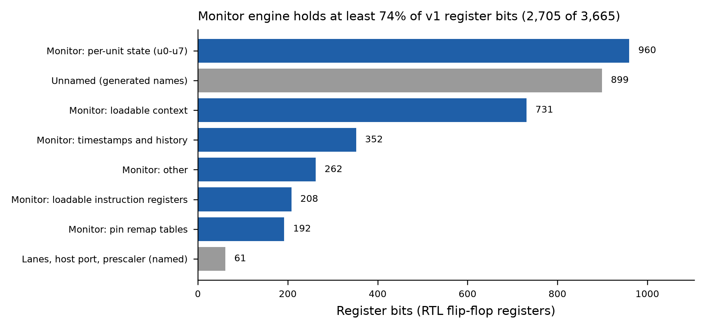

# Lessons from core v1 for the v2 design (plan v5 step 1, 2026-10-26)

Sources: `log/ci_results_v1.md` (on branch v1-tt, runs 1-3), the SG13CMOS5L tech LEF, the
v1 core Verilog, `log/harness_audit_v2.md`, `log/disagreements.md` (D13). **Fact** = read from a
log, file or tool output; **inference** = judgement, marked as such.

## 1. Facts

### 1.1 Routing stack (TT CMOS5L flow)
- Layer directions (tech LEF): Metal1 H, Metal2 V, Metal3 H, Metal4 V, TopMetal1 H; pitch 0.48 µm
  (x) / 0.42 µm (y). Signal routing is Metal2-Metal4 (`RT_MAX_LAYER = Metal4`), and Metal1 has 0
  global-routing resource. **Metal3 is the only horizontal signal layer.** Metal4 also carries
  the PDN stripes.
- A tile's height does not change with width: 6x4 and 8x4 are both 710.64 µm high, so the number of
  Metal3 tracks crossing any vertical cut (about 1,692, raw) is the same for both.

### 1.2 v1 on 8x4 (runs 2 and 3)
| | run 2 (density 60) | run 3 (density 48) |
|---|---|---|
| GRT usage / overflow | 56.81 % / 1,421 | 60.51 % / 3,129 |
| Metal2 / Metal3 / Metal4 usage | 67.8 / 73.2 / 25.4 % | 72.6 / 76.4 / 28.6 % |
| Metal3 overflow | 830 | 2,381 |
| wirelength | 3.60 m | 3.85 m |
| detailed routing | cancelled at 6 h (24,951 after iter. 2) | 88,187 TrDRC errors after the 2 antenna re-routes |

- Lowering placement density made routing worse.
- Post-CTS setup: WNS -10.022 ns before repair, -1.085 ns after (1,050 endpoints) at 16.67 ns.
  The local logic-depth estimate was 10.66 ns (slow corner, no wires).
- Hold repair: 3,515 endpoints, 499 buffers.
- Area after CTS repair: std cells 595,658 µm², which is +23.5 % over LibreLane synthesis (482,316 µm²).
  Timing-repair buffers: 8,445 cells, 101,588 µm². Flops: 3,770 cells, 184,691 µm².
- CI: GitHub cancels a job at 6 h and a cancelled job uploads no artifacts. Detailed routing
  took 63-78 min per iteration, `RepairDesignPostGRT` 67-92 min. `DRT_OPT_ITERS 1` ran
  iterations 0-1. `DRT_ANTENNA_REPAIR_ITERS` (default 3) re-runs detailed routing.

### 1.3 Where the flops are (RTL register names, `fig/v1_register_bits.png`)
- 3,665 register bits in total; the monitor engine has at least 2,705 (74 %). The largest groups are
  per-unit state u0-u7 (960 bits), the loadable context (731) and timestamps/history (352). Another
  899 bits have generated names and are not attributed.

### 1.4 Cross-layer defect (D13)
- With a package enabled, the chip admits RUN only if P ≥ min_p (7; 13 with both loadable units),
  because the time-multiplexed engine needs steps at least 8 cycles apart (T8). The I2C target
  packages need P = 3. Neither the A2 harness (spec composition, free ticks) nor the co-simulation
  (models) models admission, and no chip-level scenario runs I2C.

## 2. Inferences
- v1's netlist exceeds the Metal3 capacity of 8x4. Placement settings cannot fix this; logic and
  floorplan must change.
- The 8x4 budget (synthesis × 1.34 at 60 % density, about 503k µm²) was wrong in kind: it modelled
  area, while the binding limit was horizontal routing.
- Mapping without wires underestimates the critical path by several ns at this size.

## 3. Design rules for v2
1. **Budget from place-and-route.** No architecture freeze without a bounded CI probe on 6x4 that
   reports per-layer overflow and post-CTS slack. Synthesis area is an input, not a budget.
2. **Horizontal wiring is the scarce resource.** Use a column floorplan: each lane with its own
   memory macro and monitor slice, vertical buses, and only narrow buses (host port, register
   block, pin multiplexer) crossing the die. No storage shared across the full width.
3. **State in SRAM, not flops,** wherever the spec's timing allows it (monitor unit state,
   contexts, contract programs). The SRAM access schedule must be proved (pattern: F0/F1).
4. **Clock from post-CTS slack** at the slow corner with margin, not from logic depth. Every
   package's P is re-derived for the chosen clock.
5. **Admissibility is checked, not assumed.** A static check: each shipped package's P must be
   admissible in its shipping configuration. One chip-level (top RTL) scenario per package.
6. **Prove the composition.** A lemma on the top RTL establishes the lane-monitor wiring that the
   A2 harness assumes (`log/harness_audit_v2.md` C3).
7. **Every CI configuration ends inside 6 h.** For probes, use the `DRT_OPT_ITERS` guard and set
   `DRT_ANTENNA_REPAIR_ITERS 0`. Download each run into its own directory under `ci-artifacts/`.
8. **Grow by parameters.** Lane count, monitor units per lane and memory depth are generator
   parameters. The 8x4 set is checked by local synthesis and floorplan tests only, until 8x4 is
   opened.
