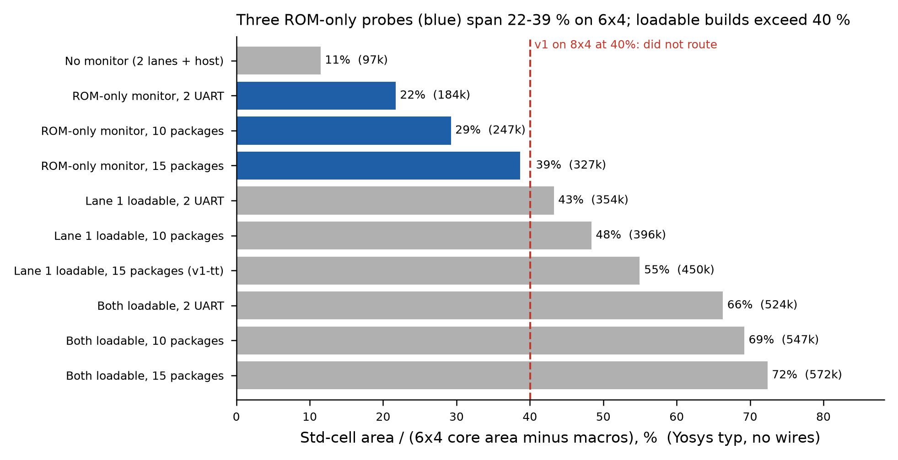

# 6x4 physical characterisation (plan v5 step 2)

Branch v2-6x4. **Fact** = measured here or read from a log; **estimate** = judgement.

## 1. Local synthesis sweep (2026-10-26, facts)

Flow: `flow/map/map_v1m.sh` (Yosys 0.69 + ABC, SG13CMOS5L, no wire load, macros as black boxes,
not counted). Netlists: `rtl_v1/bin/emit_lane_rtl.exe top_macro_mon_sweep` with `PEMU_LOADABLE`
and `PEMU_LIB`; `nomon` = `top_macro` (2 lanes + host port, no monitor). Raw output:
`log/fig/sweep_v2_step2_raw.txt`, table data: `log/fig/sweep_v2_step2.json`. The `l1_*` and
`both_uart2` rows reproduce the step-6/7 numbers (353,835 / 395,717 / 449,671 / 523.6k).

Utilisation = std-cell area / (core area minus macros). 6x4 core = 902,417 µm² (core-macro CI
metrics); 256x16 bm_bist macro = 28,127 µm² (LEF 236.8 x 118.78).

| configuration | macros | typ area (µm²) | 6x4 utilisation | slow logic depth |
|---|---|---|---|---|
| no monitor (2 lanes + host) | 2 | 97,007 | 11.5 % | 3.91 ns |
| ROM-only monitor, 2 UART | 2 | 183,611 | 21.7 % | 7.10 ns |
| ROM-only monitor, 10 packages | 2 | 247,348 | 29.2 % | - |
| ROM-only monitor, 15 packages | 2 | 327,041 | 38.6 % | 10.15 ns |
| lane 1 loadable, 2 UART | 3 | 353,835 | 43.3 % | 10.99 ns |
| lane 1 loadable, 10 packages | 3 | 395,717 | 48.4 % | - |
| lane 1 loadable, 15 packages (= v1-tt) | 3 | 449,671 | 55.0 % | - |
| both loadable, 2 UART | 4 | 523,638 | 66.3 % | - |
| both loadable, 10 packages | 4 | 546,705 | 69.2 % | - |
| both loadable, 15 packages | 4 | 571,671 | 72.4 % | - |

Differences (facts, typ):
- Monitor engine, ROM-only, 2 UART packages: +86,604 over no monitor.
- Loadable path: +170,224 for lane 1 (ROM-only to l1, 2 UART), +169,803 more for lane 0.
- ROM library from 2 UART to 15 packages: +143,430 ROM-only, +95,836 with lane 1 loadable.
  [Inference, not checked:] each ROM-carrying lane decodes its own library copy, about 72k each
  (143,430 / 2). The loadable build's +95,836 is more than one copy, consistent with the I2C
  packages making the loadable lane's mark and history bits live (log/protocols_v1.md, +371 flops).
  A per-module synthesis would settle it.
- Logic depth without wires grows from 3.9 ns (lanes) to 7.1 ns (monitor) and 10.2-11.0 ns (ROM
  library or loadable path).

Flop/logic split (facts, from each run's `stat.txt`; flops = sg13cmos5l df*/dl* cells at their
typ liberty areas; data `log/fig/sweep_flop_split.json`):

| difference | flops | flop area | logic area | total |
|---|---|---|---|---|
| monitor engine (nomon to ROM-only, 2 UART) | +973 | 47,666 | 38,938 | 86,604 |
| loadable path, lane 1 (ROM-only to l1, 2 UART) | +1,304 | 63,881 | 106,342 | 170,224 |
| loadable path, lane 0 (l1 to both, 2 UART) | +1,303 | 63,833 | 105,971 | 169,803 |
| ROM library 2 UART to 15, ROM-only | +948 | 46,441 | 96,989 | 143,430 |
| ROM library 2 UART to 15, lane 1 loadable | +586 | 28,708 | 67,129 | 95,836 |

- The loadable path is about 62 % logic (context and instruction-register selection, fetcher).
  Moving its state into SRAM removes at most its flops (about 64k per lane) unless the selection
  logic also shrinks.
- About a third of the ROM-library cost is flops. Synthesis prunes per-unit state bits that no
  shipped package can reach; larger timing constants make them live (as found for I2C in step 7).
  Per-unit counter width is therefore a v2 design parameter, not a fixed cost.
- Flop totals match earlier measurements (l1_lib10 3,389 and l1_all 3,760, log/protocols_v1.md).

For reference, v1-tt on 8x4 (lane 1 loadable, 15 packages, 3 macros) sits at 40.0 % on the same
metric, and it did not route (log/ci_results_v1.md, runs 2-3).

## 2. CI probes (prepared, waiting for the push)

Three branches, one netlist family (ROM-only monitor, 2 macros), so that routing difficulty is
measured against utilisation with everything else fixed:

| branch | library | typ area | 6x4 utilisation | commit |
|---|---|---|---|---|
| probe6x4-uart2 | 2 UART | 183,611 | 21.7 % | be13c8d |
| probe6x4-lib10 | 10 packages | 247,348 | 29.2 % | 57173b0 |
| probe6x4-all | 15 packages | 327,041 | 38.6 % | ae3d5a2 |

(The commit messages quote die-based utilisation, 21.4 / 28.8 / 38.0 %. The table above uses the
core-based metric.)

Common settings: 6x4, `CLOCK_PERIOD` 20 ns, `PL_TARGET_DENSITY_PCT` 60, `DRT_OPT_ITERS` 1
(iterations 0-1, as in v1-tt run 3), `DRT_ANTENNA_REPAIR_ITERS` 0 (avoids the re-routes that
tripled violations in run 3; antenna sign-off will then fail, which is acceptable for a probe),
post-GRT repair on, KLayout DRC on, Magic DRC off. Floorplan: `u_imem_l1` at (3.36, 41.58) FS,
which is v1's left-column position; `u_imem_l0` at (981.44, 41.58) FS, which is v1's lane-0 position
shifted by 10 stripe pitches (same stripe alignment). The lane-0 macro leaves a 68.16 µm gap to the
core edge. There are 7 PDN obstructions.

Local checks per branch (facts):
- `flow/pdn/test_floorplan_v1.py` with the 6x4 die: 6/6 pass (C1-C4 in both instance orders,
  obstructions exactly the misaligned pairs, both negative controls). An extra negative check with
  the lane-0 macro one pitch to the right (23.2 µm channel) fails the narrow-channel test, as it
  should.
- RTL replay with cocotb 2.0.1 and Icarus against the IHP SRAM models: 3/3 (v1_rom_uart,
  v1_reset_mid, comparator negative control). The vectors are regenerated per configuration by
  `dump_tt_vectors_v1.exe`. With default settings the generator reproduces the v1-tt vectors byte
  for byte.
- COMBDLY post-process applied (`tools/fix_combdly.py`). **Not done for the probes:** Yosys
  equivalence of the post-processed netlist (842 s on v1) and E4/E5. Probes are physical
  measurements, not sign-off.

What each run should return (to be filled in from the artifacts): GRT usage and overflow per layer,
DRT violations after iterations 0 and 1, post-CTS setup WNS/TNS at 20 ns and the slack implied at
16.67 and 25 ns [estimate: WNS shifted by the period change, valid only if the critical path does
not change], hold buffer count, std-cell growth over synthesis, A_DOUT max-cap, stage runtimes.

## 3. CI probe results (runs of 2026-10-26/27, facts from the gds job logs)

Runs: probe6x4-uart2 40420618996, probe6x4-lib10 40420619616, probe6x4-all 40420619385. All three
ran the whole flow (70 steps, through Netgen LVS) and then failed with "harden failed" on the
deferred checks. That is expected: detailed routing was capped at iterations 0-1 and antenna repair
was off. Precheck and gate-level jobs were skipped because the gds job failed.

| | uart2 (21.7 %) | lib10 (29.2 %) | all (38.6 %) | v1-tt run 3, 8x4 (40.0 %) |
|---|---|---|---|---|
| effective utilisation (IFP-0104) | 0.283 | 0.356 | 0.451 | 0.469 |
| GRT usage M2 / M3 / M4 | 24.8 / 31.3 / 1.2 % | 39.2 / 48.8 / 5.0 % | 70.0 / 79.5 / 26.5 % | 72.6 / 76.4 / 28.6 % |
| GRT overflow (total) | **0** | **0** | 77 | 3,129 |
| wirelength | 0.99 m | 1.55 m | 2.82 m | 3.85 m |
| DRT violations after iter. 0 / 1 | 7,218 / 3,833 | 13,496 / 7,455 | 25,489 / 13,678 | 47,509 / 29,241 |
| DRT time (2 iterations) | 27 min | 44 min | 65 min | 141 min |
| setup at 20 ns after CTS | no violations | no violations | 948 endpoints, WNS -6.312 -> +0.051 ns after repair | (16.67 ns) -1.085 ns |
| std cells after CTS repair | 254,263 | 330,654 | 432,344 | 595,658 |
| growth over Yosys typ | 1.385 | 1.337 | 1.322 | 1.235 (over LibreLane synth) |
| timing-repair buffers | 3,854 (50.4k) | 4,787 (59.2k) | 6,171 (73.2k) | 8,445 (101.6k) |
| KLayout DRC errors | 1,325 | 2,455 | 4,243 | - |
| total job time | 41 min | 62 min | 102 min | cancelled at 6 h |

Residual DRT violations are mostly Metal2 shorts and spacing (uart2: 2,283 shorts, 1,336 spacing).
KLayout DRC categories are not read yet (they are in the GDS_logs artifacts). Hold-buffer counts
from the log are not reported: the parse gave inconsistent numbers.

Findings:
- **Global routing fits with zero overflow up to 29 % utilisation** (lib10). At 38.6 % (all), 6x4
  still routes globally with 77 overflow against v1-tt's 3,129 on 8x4 at a similar utilisation.
  [Inference:] the difference comes from the loadable path and its cross-die store, which these
  netlists do not have.
- **Detailed routing was not allowed to converge**, so these runs do not show that the designs
  route clean. Iterations take 11-28 min here against 63-78 min on v1, so a full detailed route
  (default DRT_OPT_ITERS 64) fits inside 6 h for uart2 and lib10 [estimate: about 10 iterations,
  with later ones shorter].
- **20 ns closes setup** for all three after CTS (the 15-package library needs repair from -6.3 ns).
  60 MHz was not tested.
- **Area growth from Yosys typ to post-CTS std cells is 1.32-1.39x**, so v1's assumed 1.34x was
  about right for area. v1's budget failed on routing, which area does not predict. For v2,
  budgets are set by measured GRT overflow (zero at <= 29 % here), with area growth as a secondary
  check.

## 4. Known limitation

None of the probes contains the loadable path or a column floorplan. They measure
how routability scales with the ROM-only family; v2's own floorplan is checked again at step 5.
